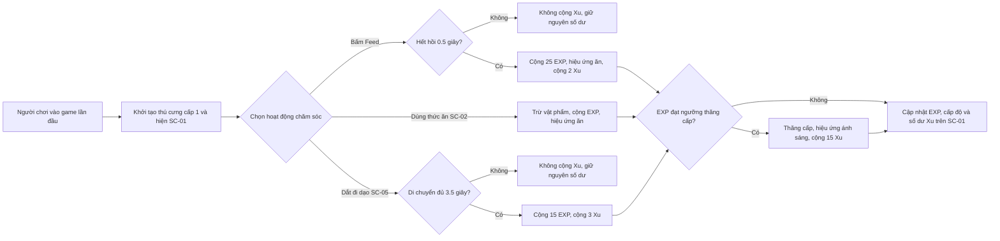
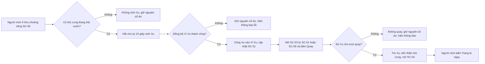

# MD-01. Chăm sóc thú cưng

Quản lý thông tin và sự phát triển của thú cưng do người chơi sở hữu.
Cung cấp cơ chế cho ăn, dắt thú cưng đi dạo, quản lý túi đồ thức ăn, vòng quay Gacha, khu chuồng riêng và thăng cấp độ.

## Thực thể
### Thú cưng
| Thuộc tính | Nghĩa | Ràng buộc |
|---|---|---|
| Mã định danh | Mã duy nhất của thú cưng | Bắt buộc, chuỗi ký tự |
| Loài | Tên giống thú cưng | Bắt buộc, ví dụ Shiba |
| Độ hiếm | Cấp bậc phân loại từ vòng quay | Bắt buộc, một trong Common, Rare, Epic, Legendary, Mythic |
| Giới tính | Phân loại giống đực hoặc cái | Bắt buộc, một trong Male, Female |
| Cấp độ | Cấp độ phát triển hiện tại | Bắt buộc, số nguyên dương từ 1 |
| EXP hiện tại | Điểm kinh nghiệm đã tích lũy | Bắt buộc, số nguyên từ 0 |
| EXP tối đa | Ngưỡng điểm để thăng cấp tiếp theo | Bắt buộc, số nguyên dương |
| Sức mạnh | Chỉ số chiến đấu cơ bản | Bắt buộc, số nguyên dương |
| Trạng thái thả vườn | Cho biết thú cưng có đang được thả tự do trong khuôn viên vườn riêng hay không | Bắt buộc, một trong Đang thả vườn, Không thả vườn |

## Vòng đời
### Thú cưng
| Mã | Từ | Sự kiện | Sang | Điều kiện |
|---|---|---|---|---|
| TR-01 | (mới) | Người chơi vào game | Cấp 1 | BR-01 |
| TR-02 | Đang nuôi | Cho ăn đủ điểm EXP | Thăng cấp | BR-02 |

## Quy tắc
- **BR-01** Khi người chơi gia nhập game lần đầu → hệ thống tự động cấp một thú cưng khởi đầu là chú chó Shiba ở cấp độ 1.
- **BR-02** Khi thú cưng nhận đủ điểm kinh nghiệm đạt ngưỡng thăng cấp → hệ thống tự động tăng Level thêm 1 và trừ điểm kinh nghiệm theo ngưỡng của cấp đó.
- **BR-03** Khi người chơi bấm nút Feed → hệ thống cộng 25 điểm EXP cho thú cưng đang chọn và áp dụng thời gian hồi 0.5 giây.
- **BR-04** Khi thăng cấp → hệ thống tăng EXP tối đa thêm 50 điểm và tăng sức mạnh thêm 5 điểm.
- **BR-05** Khi dắt thú cưng đi dạo di chuyển trong sân → hệ thống cộng 15 điểm EXP định kỳ mỗi 3.5 giây.
- **BR-06** Khi người chơi quay Gacha → hệ thống chọn ngẫu nhiên thú cưng theo 5 cấp độ với tỷ lệ: Thông Thường (50%), Hiếm (28%), Siêu Hiếm (14%), Huyền Thoại (6%), Thần Thoại (2%).
- **BR-07** Khi người chơi trang bị thú cưng mới → hệ thống chuyển linh thú đồng hành theo người chơi và cập nhật lại chỉ số sức mạnh tương ứng.
- **BR-08** Khi người chơi gia nhập phòng game → hệ thống tự động gán 1 trong 6 chuồng thú cưng riêng biệt có biển tên hiển thị tên người chơi và điểm xuất phát tại chuồng; khi người chơi thoát → chuồng được giải phóng về trạng thái sẵn sàng.
- **BR-09** Khi người chơi sở hữu nhiều thú cưng → có thể thả từ 5 đến 10 chú chó ra dạo chơi tự do trong khuôn viên vườn riêng của mình; mỗi chú chó mang giới tính Đực (♂) hoặc Cái (♀) với đặc điểm ngoại hình riêng biệt.
- **BR-10** Khi thú cưng ở trong khuôn viên vườn riêng → hệ thống tự động điều khiển di chuyển tự do, linh hoạt trong phạm vi rào chắn (đi dạo ngẫu nhiên, ghé thăm bát ăn, bát nước, đệm nằm, dốc đồ chơi) với hiệu ứng bước đi nhấp nhô vui vẻ (Bouncy Walk) và hành vi ngẫu nhiên (ngửi đất, nhảy cẫng, xoay vòng) mà không vượt quá hàng rào.
- **BR-14** Khi người chơi thực hiện hoạt động chăm sóc thú cưng → hệ thống tự động cộng Xu thưởng vào Ví Xu (MD-02) theo mức cố định: bấm nút Feed cộng 2 Xu, thú cưng thăng cấp cộng 15 Xu, dắt thú cưng đi dạo di chuyển đủ chu kỳ 3.5 giây cộng 3 Xu.
- **BR-15** Trong khi thú cưng có trạng thái Đang thả vườn trong khuôn viên vườn riêng → hệ thống tự động sinh 2 Xu cho mỗi thú cưng đang thả sau mỗi chu kỳ 15 giây và cộng trực tiếp vào Ví Xu (MD-02), không áp dụng hệ số nhân theo độ hiếm và không giới hạn mức Xu tích trữ.

## Quyền
| Quyền | Nghĩa | Vai |
|---|---|---|
| pet:feed | Cho thú cưng ăn | Người chơi |
| pet:walk | Dắt thú cưng đi dạo | Người chơi |
| pet:bag | Mở túi đồ hành trang | Người chơi |
| pet:gacha | Quay vòng quay thú cưng | Người chơi |
| pet:equip | Trang bị thú cưng | Người chơi |
| pet:roam | Thả thú cưng tự do trong vườn | Người chơi |
| plot:claim | Sở hữu chuồng riêng trong phòng | Người chơi |

## Màn hình
| Mã | Màn hình | App | Ghi chú |
|---|---|---|---|
| SC-01 | Giao diện chính MainHUD | . | Chứa thẻ thông tin thú cưng, khu vực hiển thị số dư Xu hiện tại và thanh công cụ cạnh phải |
| SC-02 | Cửa sổ túi đồ InventoryModal | . | Hiển thị danh sách vật phẩm thức ăn và đồ chơi |
| SC-03 | Cửa sổ quay GachaModal | . | Hiển thị tỷ lệ 5 cấp độ và nút quay x1 (100 Xu), x5 (450 Xu) |
| SC-04 | Cửa sổ kết quả GachaResultPopup | . | Hiển thị thú cưng vừa trúng kèm nút trang bị |
| SC-05 | Khu chuồng thú cưng 6 người chơi | . | 6 khuôn viên riêng biệt có nhà doghouse, hàng rào và bát ăn |
| SC-06 | Quảng trường Gacha và Đấu trường Solo | . | Khu vực quay trứng thần bí và võ đài chiến đấu solo |

## Dùng của mảng khác
- Đọc số dư và cộng trừ Xu trên thực thể Ví Xu của MD-02 (hiển thị trên SC-01 ở F-02, trừ Xu khi quay Gacha ở F-04, cộng Xu từ chăm sóc ở F-06 và từ thú cưng thả vườn ở F-07).

## Luồng
### Chăm sóc thú cưng, tích lũy Xu và hiệu ứng phát triển

1. Người chơi gia nhập game lần đầu; hệ thống khởi tạo thú cưng cấp 1 và hiển thị thông tin cùng số dư Xu trên SC-01 (F-01, F-01-R1, TR-01, F-02, F-02-R1, F-02-R4).
2. Khi Người chơi bấm nút Feed ngoài thời gian hồi 0.5 giây trên SC-01, hệ thống cộng 25 EXP, phát hiệu ứng hạt thức ăn và cộng 2 Xu vào Ví Xu; nếu bấm trong thời gian hồi thì không cộng Xu (F-01, F-01-R2, F-03, F-03-R1, F-06, F-06-R1, F-06-R4, TR-04).
3. Khi Người chơi mở SC-02 và dùng vật phẩm thức ăn, hệ thống trừ vật phẩm, cộng EXP và phát hiệu ứng hạt thức ăn, không cộng Xu Feed trực tiếp (F-02, F-02-R3, F-01, F-01-R5, F-03, F-03-R1, F-06, F-06-R6).
4. Khi Người chơi bật dây dắt thú cưng và di chuyển liên tục đủ 3.5 giây trong SC-05, hệ thống cộng 15 EXP và cộng 3 Xu vào Ví Xu; nếu đứng yên hoặc tắt dây dắt trước 3.5 giây thì không cộng Xu (F-01, F-01-R4, F-06, F-06-R3, F-06-R5, TR-04).
5. Khi điểm EXP đạt ngưỡng thăng cấp, thú cưng chuyển sang cấp mới, phát cột ánh sáng vàng và cộng thêm 15 Xu thưởng thăng cấp vào Ví Xu; nếu mất kết nối máy chủ thì không ghi nhận giao dịch cộng Xu ở máy khách (F-01, F-01-R3, TR-02, F-03, F-03-R2, F-06, F-06-R2, F-06-R7, TR-04).
6. Giao diện SC-01 và SC-07 cập nhật cấp độ, thanh tiến trình EXP và số dư Xu mới nhất cho Người chơi (F-02, F-02-R1, F-02-R4, F-06).

### Sinh Xu thả vườn và quay Gacha nhận thú cưng mới

1. Khi Người chơi ở trong phòng game tại SC-05 và có ít nhất một thú cưng Đang thả vườn, cứ hết mỗi chu kỳ 15 giây hệ thống cộng Xu vào Ví Xu và cập nhật số dư trên SC-01 và SC-07; nếu đồng bộ Ví Xu thất bại thì giữ nguyên số dư và hiện thông báo F-07-M1 (F-07, F-07-R1, F-07-R2, F-07-R6, TR-04, F-02, F-02-R4).
2. Nếu không có thú cưng Đang thả vườn hoặc Người chơi thoát phòng game, hệ thống không sinh Xu hoặc dừng bộ đếm chu kỳ hiện tại (F-07, F-07-R3, F-07-R5).
3. Người chơi mở cửa sổ quay Gacha SC-03 từ SC-01 hoặc SC-06 và chọn Quay 1 lần hoặc Quay 5 lần; nếu không đủ Xu thì hệ thống giữ nguyên số dư và hiện thông báo F-04-M1 (F-04, F-04-R4).
4. Khi đủ Xu, hệ thống trừ Xu trong Ví Xu, bốc thăm ngẫu nhiên 1 hoặc 5 thú cưng, cập nhật số dư trên SC-01 và mở cửa sổ kết quả SC-04 (F-04, F-04-R1, F-04-R2, TR-05, F-02, F-02-R4).
5. Tại SC-04, Người chơi bấm Trang bị ngay để đổi thú cưng đồng hành theo sau nhân vật (F-04, F-04-R3).
