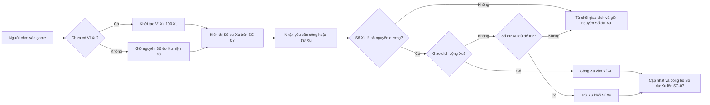

# MD-02. Kinh tế Xu

Quản lý đơn vị tiền tệ Xu, khởi tạo số dư ban đầu và ghi nhận cộng trừ số dư Xu của người chơi.

## Thực thể
### Ví Xu
| Thuộc tính | Nghĩa | Ràng buộc |
|---|---|---|
| Mã người chơi | Định danh duy nhất của người chơi sở hữu ví | Bắt buộc, duy nhất, mỗi người chơi có đúng một Ví Xu |
| Số dư Xu | Số lượng Xu hiện có của người chơi | Bắt buộc, số nguyên không âm từ 0 trở lên theo BR-11 |
| Đã nhận Xu khởi đầu | Đánh dấu người chơi mới đã nhận 100 Xu ban đầu hay chưa | Bắt buộc, đúng hoặc sai, chỉ chuyển sang đúng một lần duy nhất |

## Vòng đời
### Ví Xu
| Mã | Từ | Sự kiện | Sang | Điều kiện |
|---|---|---|---|---|
| TR-03 | (mới) | Người chơi mới gia nhập game lần đầu | Đang hoạt động | BR-12 |
| TR-04 | Đang hoạt động | Ghi nhận giao dịch cộng Xu hợp lệ | Đang hoạt động | BR-11, BR-13 |
| TR-05 | Đang hoạt động | Ghi nhận giao dịch trừ Xu hợp lệ | Đang hoạt động | BR-11, BR-13 |

## Quy tắc
- **BR-12** Khi người chơi mới gia nhập game lần đầu → hệ thống khởi tạo Ví Xu với số dư ban đầu là 100 Xu và chỉ tặng một lần duy nhất cho mỗi người chơi.
- **BR-13** Luôn → mỗi giao dịch cộng hoặc trừ Xu chỉ chấp nhận số lượng là số nguyên dương và cập nhật trực tiếp vào số dư Ví Xu theo BR-11.

## Màn hình
| Mã | Màn hình | App | Ghi chú |
|---|---|---|---|
| SC-07 | Khung hiển thị Ví Xu (CoinHUD) | . | Hiển thị số dư Xu hiện tại kèm đơn vị Xu theo UI-06, nhúng trên giao diện chính của trò chơi |

## Luồng
### Khởi tạo và giao dịch Ví Xu

1. Người chơi mới gia nhập trò chơi lần đầu: hệ thống khởi tạo Ví Xu sang trạng thái Đang hoạt động với Số dư Xu bằng 100, đánh dấu Đã nhận Xu khởi đầu là đúng và hiển thị trên SC-07 (F-05, F-05-R1, TR-03, SC-07).
2. Người chơi cũ gia nhập lại trò chơi: hệ thống không tặng lại 100 Xu khởi đầu và hiển thị Số dư Xu hiện có trên SC-07 (F-05, F-05-R2, SC-07).
3. Hệ thống nhận yêu cầu cộng hoặc trừ Xu và xử lý tuần tự các giao dịch đồng thời trên cùng một Ví Xu; nếu số lượng Xu bằng 0, số âm hoặc không phải số nguyên thì từ chối và giữ nguyên Số dư Xu (F-05, F-05-R6, F-05-R7).
4. Với giao dịch cộng Xu hợp lệ: hệ thống cộng vào Số dư Xu của Ví Xu và cập nhật hiển thị trên SC-07 (F-05, F-05-R3, TR-04, SC-07).
5. Với giao dịch trừ Xu hợp lệ: nếu Số dư Xu lớn hơn hoặc bằng số Xu cần trừ thì trừ khỏi Ví Xu và cập nhật hiển thị trên SC-07; nếu số dư không đủ thì từ chối và giữ nguyên Số dư Xu (F-05, F-05-R4, F-05-R5, TR-05, SC-07).
6. Nếu mất kết nối trong lúc giao dịch: hệ thống giữ nguyên Số dư Xu đã ghi nhận trên máy chủ và đồng bộ lại lên SC-07 khi kết nối phục hồi (F-05, F-05-R8, SC-07).
