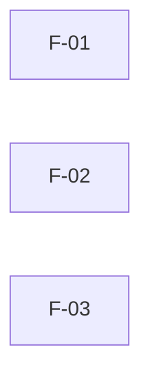

<!-- pp-kit:generated plan · engine sinh từ cây docs (roadmap.mjs --write), đừng sửa tay -->
# Kế hoạch

Đơn vị đường găng: tổng Cỡ của task (S=1, M=2, L=3), tương đối, không phải giờ. Tiến độ: `/pp-kit:next`.

## Giai đoạn 1

### Chưa chia task

- F-01 · Cho ăn và tăng cấp thú cưng
- F-02 · Giao diện HUD thú cưng
- F-03 · Hiệu ứng phát triển thú cưng

## Phụ thuộc giữa F

