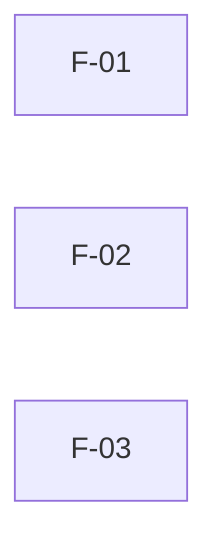

<!-- pp-kit:generated plan · engine sinh từ cây docs (roadmap.mjs --write), đừng sửa tay -->
# Kế hoạch

Đơn vị đường găng: tổng Cỡ của task (S=1, M=2, L=3), tương đối, không phải giờ. Tiến độ: `/pp-kit:next`.

## Giai đoạn 1

Đường găng (4): F-01-T01 → F-01-T02 → F-01-T03 → F-01-T04

### Đợt 1

| Task | F | Tên | Loại | Cỡ | Ưu tiên | Sau |
|---|---|---|---|---|---|---|
| F-01-T01 | F-01 | Khởi tạo cấu hình và dữ liệu thú cưng ban đầu | BE | S | must | — |
| F-02-T01 | F-02 | Xây dựng thẻ thông tin thú cưng và thanh EXP | FE | S | must | — |
| F-03-T01 | F-03 | Cài đặt hiệu ứng hạt thức ăn khi cho ăn | FE | S | must | — |

### Đợt 2

| Task | F | Tên | Loại | Cỡ | Ưu tiên | Sau |
|---|---|---|---|---|---|---|
| F-01-T02 | F-01 | Xử lý logic cho ăn và cộng EXP trên Server | BE | S | must | F-01-T01 |
| F-01-T05 | F-01 | Cài đặt logic dắt chó đi dạo và nhận EXP định kỳ | BE | S | must | F-01-T01 |
| F-02-T02 | F-02 | Thiết kế thanh công cụ cạnh phải | FE | S | must | F-02-T01 |
| F-03-T02 | F-03 | Cài đặt cột sáng vàng và hạt pháo hoa khi Level Up | FE | S | must | F-03-T01 |

### Đợt 3

| Task | F | Tên | Loại | Cỡ | Ưu tiên | Sau |
|---|---|---|---|---|---|---|
| F-01-T03 | F-01 | Xử lý thăng cấp Level và tăng chỉ số sức mạnh | BE | S | must | F-01-T02 |
| F-01-T06 | F-01 | Xử lý sử dụng vật phẩm thức ăn từ túi đồ | BE | S | must | F-01-T02 |
| F-02-T03 | F-02 | Kiểm thử hiển thị giao diện HUD | QA | S | must | F-02-T02 |
| F-02-T04 | F-02 | Thiết kế cửa sổ Popup túi đồ hành trang | FE | S | must | F-02-T02 |
| F-03-T03 | F-03 | Kiểm thử hiệu ứng phát triển thú cưng | QA | S | must | F-03-T02 |

### Đợt 4

| Task | F | Tên | Loại | Cỡ | Ưu tiên | Sau |
|---|---|---|---|---|---|---|
| F-01-T04 | F-01 | Kiểm thử tự động luồng cho ăn và tăng cấp | QA | S | must | F-01-T03 |

## Phụ thuộc giữa F

